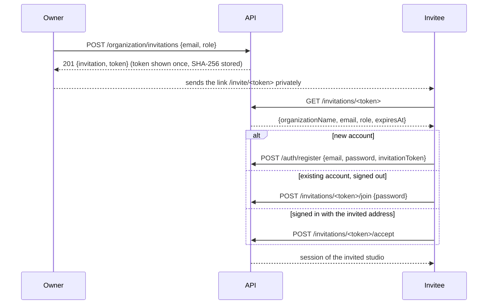

# Authentication and authorization

## Sessions

The API uses a stateless bearer token: a JWT signed with HS256 and the server's `JWT_SECRET` (at least 32 characters).

| Property | Value |
| --- | --- |
| Header | `Authorization: Bearer <token>` |
| Issued by | `POST /auth/register`, `POST /auth/login`, `POST /invitations/{token}/join`, `POST /invitations/{token}/accept` |
| Claims | `sub` user id, `org` studio id, `role` (informational only) |
| Lifetime | 7 days (`SESSION_TTL_SECONDS`) |
| Refresh | None: sign in again when a call answers `401` |
| Logout | Client side only: drop the token. There is no server-side revocation list |

On **every** request, `requireAuth` verifies the signature and expiry, then reads the user's **membership from the database**. The role in the token is ignored. As a result:

* a member removed from the studio is refused at once (`401 UNAUTHENTICATED`, "The session is no longer valid"), even with an unexpired token;
* a changed role applies from the next request on.

## Public routes

These need no token. Each is public for a stated reason, and the list is enforced by `apps/api/src/routes/__tests__/route-auth.spec.ts`: a new route fails that test until it is classified.

| Route | Why it is public |
| --- | --- |
| `GET /health` | Docker health check |
| `POST /auth/register`, `POST /auth/login` | They issue the token |
| `GET /invitations/{token}`, `POST /invitations/{token}/join` | The invitation token in the link is the secret |
| `/track/*` | Called by email clients and by the published prototype pages, which have no session |
| `GET /mvp/preview/{slug}` | Loaded in an `<iframe>`, which cannot send a header; the random slug is the secret |

## Roles

| Role | Read | Write (POST/PATCH/DELETE on leads, audits, MVP, outreach, discovery) | Members and invitations |
| --- | --- | --- | --- |
| `owner` | ✅ | ✅ | ✅ |
| `operator` | ✅ | ✅ | ❌ `403` |
| `viewer` | ✅ | ❌ `403 FORBIDDEN` | ❌ `403` |

`requireWriter` lets `GET`, `HEAD` and `OPTIONS` through and checks the role on everything else; `requireOwner` guards `/organization/*`. The last owner of a studio cannot be demoted or removed (`409 LAST_OWNER`).

## Studio isolation (multi-tenancy)

Leads, MVPs, campaigns and events belong to one studio (`tenantId`). The API reaches them only through `req.tenant` (`scopeFor()` in `apps/api/src/data/tenant-scope.ts`), which adds the studio filter to every query; a test (`tenant-guard.spec.ts`) fails if any route queries those models directly.

**A record of another studio answers exactly like a missing one** (`404 LEAD_NOT_FOUND`, `404 MVP_NOT_FOUND`, …), so a client cannot probe which ids exist. Audits are shared per business (a site is audited once), but an audit is returned only to a studio that has a lead reading it.

## Invitations

An invitation works once and expires after 7 days (`410 INVITATION_EXPIRED`); creating a new one for the same address revokes the older. The address is fixed: `403 INVITATION_EMAIL_MISMATCH` otherwise.

## Security notes

* **Store the token like a password.** The dashboard keeps it in local storage; on a shared machine, sign out.
* **Passwords** are 10–128 characters and stored as hashes; login answers the same `401 INVALID_CREDENTIALS` for a wrong password and an unknown email, and runs a dummy hash for unknown emails so timing does not reveal accounts.
* **No email verification** at registration: whoever holds an invitation link can register the invited address. Send links privately.
* **CORS:** only `CORS_ORIGIN` (the dashboard) may call the API from a browser; `/track/*` also accepts the demo storage and `https://{PREVIEW_DOMAIN}` with credentials, because `navigator.sendBeacon` always sends them.
* **Rate limiting** is not implemented yet (see [concepts.md](concepts.md#rate-limits)); do not expose `/auth/login` to the internet without a limiting proxy.
* **Secrets** never travel in URLs except the one-time invitation token, the preview slug and the tracking token, which are random and scoped to one resource.
