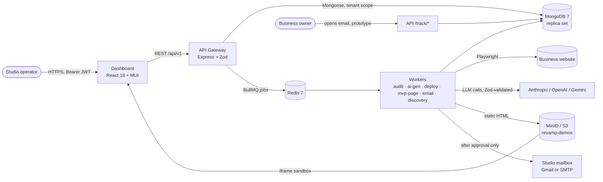
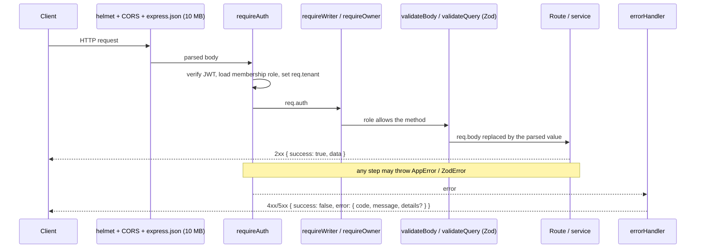
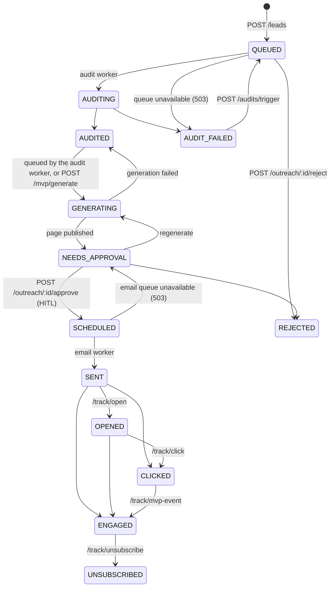
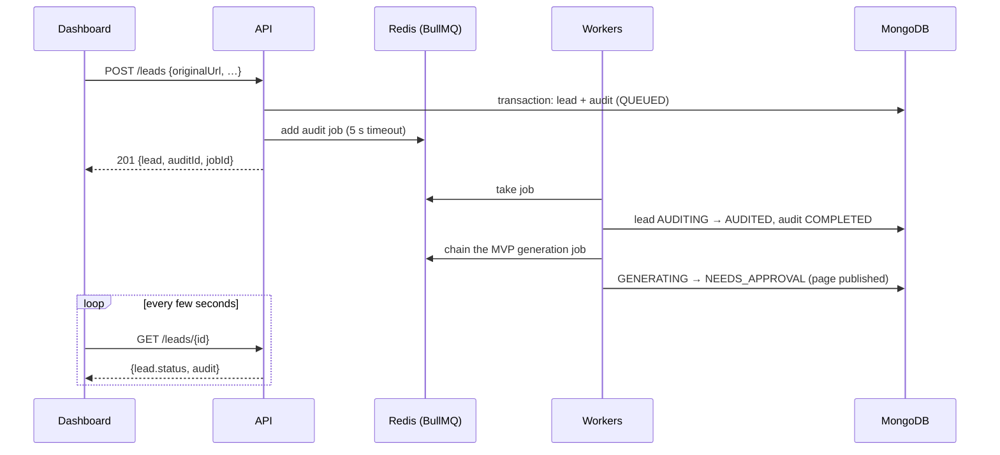

# Concepts

How the API fits into the system, and the rules that hold across all endpoints. The diagrams are Mermaid; GitHub and most Markdown viewers render them.

## System context

Outreach is sent from the studio's own mailbox (Gmail through OAuth, or SMTP); the platform never sends under its own name. Until [REV-221](https://linear.app/revamp-proect/issue/REV-221) ships, one platform-wide provider (`EMAIL_PROVIDER`: Resend, SendGrid or SMTP, with a global `EMAIL_FROM`) sends for every studio.

| Module (tag) | Resources | Owns |
| --- | --- | --- |
| Auth, Organization, Invitations | users, studios, memberships, invitations | Who the caller is and what they may do |
| Leads | `leads`, `businesses` | The business a studio pursues and its pipeline status |
| Audits | `audits` | Deterministic measurements of the site (shared per business) |
| MVP | `mvpprojects`, demos bucket | The prototype page, its versions and the operator's changes |
| Outreach | `emailcampaigns` | The approval gate and the email |
| Discovery | BullMQ job results | Candidate businesses from maps providers |
| Tracking | `analyticsevents` | Opens, clicks, prototype engagement, unsubscribes |

## Request lifecycle

Every request passes the same chain (`apps/api/src/app.ts`, `routes/index.ts`):

Unknown fields in a body are dropped by Zod, except in the `.strict()` schemas (those marked `additionalProperties: false` in the reference), which answer `400 VALIDATION_ERROR`.

## Lead lifecycle

A lead's `status` moves only along `LEAD_TRANSITIONS` (`@revamp/validation`). Every write uses an atomic filter (`findOneAndUpdate({ _id, status: { $in: leadStatusesInto(to) } })`), so a stale job or a late tracking hit never moves a lead backwards.

Not drawn: `REJECTED` is reachable from every status before `SCHEDULED` (and from `SCHEDULED` only by the email worker's MX bounce), and `UNSUBSCRIBED` from every status.

**Human-in-the-Loop.** No worker sends an email on its own. The only way into `SCHEDULED` is `POST /outreach/{id}/approve`, called by a signed-in owner or operator with the final subject and body.

## Asynchronous work: queue, answer, poll

Audits take about 40 s, a generation minutes, so the API never waits for them:

| Pattern | Endpoints | Client behaviour |
| --- | --- | --- |
| **Queue and poll** (`201`/`202`) | `POST /leads`, `/audits/trigger`, `/mvp/generate`, `/discovery`, `/discovery/{jobId}/import` | Poll `GET /leads/{id}` or `GET /discovery/{jobId}` |
| **Wait for the worker** (`200` after the job) | `POST /mvp/{id}/edit` (≤ 420 s), `PATCH /mvp/{id}/tokens` and `.../restore` (≤ 120 s), `POST /outreach/{id}/test` (≤ 30 s) | Show progress; on `504` reload the resource before retrying |
| **Enqueue or revert** | `POST /leads`, `/audits/trigger`, import (→ `AUDIT_FAILED`, `503 AUDIT_QUEUE_UNAVAILABLE`); approve (→ back to `NEEDS_APPROVAL`, `503 EMAIL_QUEUE_UNAVAILABLE`) | The record is in a known state; retry the action |

There are no webhooks or server-sent events; polling is the contract.

## Pagination

Only `GET /leads` is paginated, with **offset pagination**:

| Parameter | Default | Range |
| --- | --- | --- |
| `page` | 1 | ≥ 1 |
| `limit` | 20 | 1–100 |

The response carries `pagination: { total, page, limit, totalPages }`; results are sorted with one-page brochure sites first, then newest first (`LEAD_LIST_SORT`). Filters (`status`, `niche`, `complexity`, `search`) apply before counting. Offset pagination was chosen because a studio has hundreds of leads, not millions, and the dashboard needs `total` for its counters; the cost is that a lead added between two page reads shifts the pages (the dashboard reads all pages at once with `limit=100`). Lists that are bounded by design are not paginated: `/outreach/pending` returns at most 50, discovery at most 100 candidates per search.

## Idempotency and concurrency

There is no `Idempotency-Key` header. Instead, each state-changing call is safe to repeat because of a precondition in the database:

| Call repeated | Result |
| --- | --- |
| `POST /leads` with the same site | `409 LEAD_ALREADY_EXISTS` with `details.leadId` (unique index per studio and business) |
| `POST /outreach/{id}/approve` twice, even at the same moment | One succeeds; the other answers `409 LEAD_NOT_AWAITING_APPROVAL` (transaction filtered on the status). One email at most |
| `POST /mvp/generate` twice | The second answers `409 MVP_GENERATION_NOT_ALLOWED` (the lead is `GENERATING`) |
| `POST /track/unsubscribe/{token}` | `200` every time; the first one changes the status |
| `POST /mvp/{id}/versions/{n}/restore` of the published page | `200 { applied: false, reason: "unchanged" }` |

A lead has at most one `MvpProject` and one `EmailCampaign` (unique `leadId`), written with upserts.

## Rate limits

**Not implemented.** The API applies no request quota. The only throttling is on outgoing email: each approved send is delayed 15–45 s at random. Before a public deployment, `/auth/login` and `/auth/register` need a limiter, in the API or at the reverse proxy in front of it. Clients should still back off on `5xx` and `504`.

## Versioning

* The major version is in the path: `/api/v1` (`API_PREFIX`). A breaking change (a removed field or endpoint, a changed meaning) would ship as `/api/v2` alongside v1.
* Within v1, changes are additive: new optional fields, new endpoints, new error codes. Clients must ignore unknown fields and treat an unknown `error.code` like its HTTP status.
* The specification version (`info.version`) follows SemVer and every change is listed in [CHANGELOG.md](../CHANGELOG.md), with the REV ticket that made it.
* Removed endpoints are listed in the changelog with their replacement (for example `PATCH /mvp/{id}/layout`, removed in REV-139).

## Data conventions

* Ids are 24-character hexadecimal MongoDB ObjectIds; a malformed id answers `400 INVALID_ID`.
* Dates are ISO 8601 strings in UTC.
* A measurement that failed is **absent**, never `0` or a placeholder, and the failure is listed (`Audit.measurementErrors`). Contact data comes only from the site's DOM, never from a model.
* Text the operator reads (`message`) is English; the dashboard translates by `code`.
