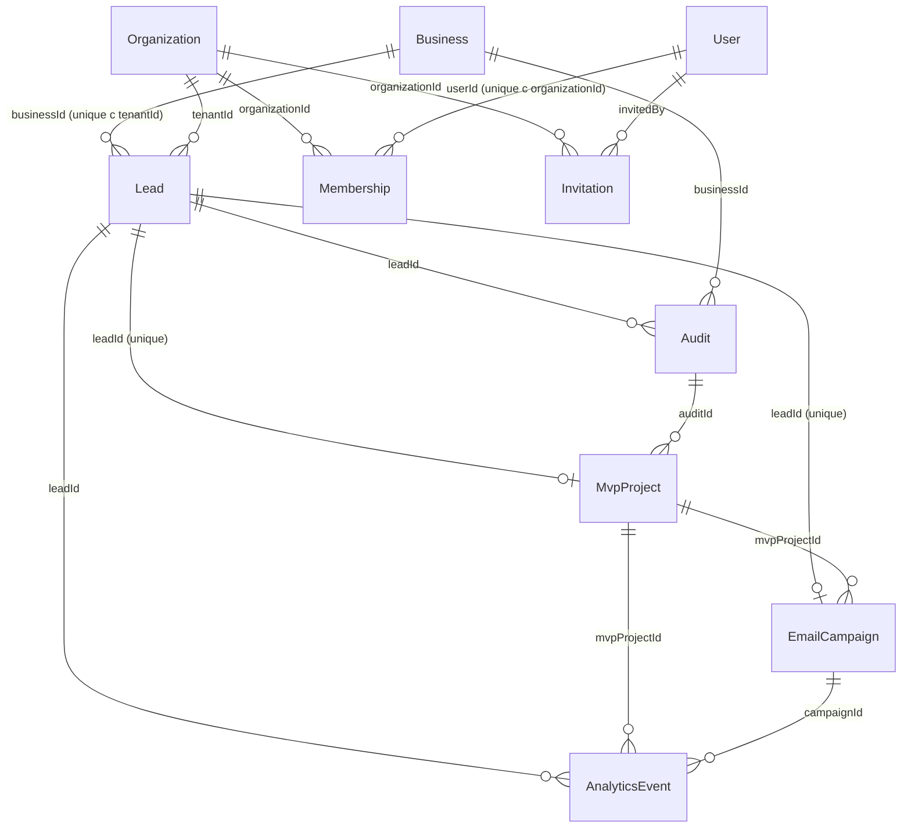

# Database expertise: Revamp — База данных, описание и обоснование

21 ноября 2026

## 1. Репозиторий и README

Код и документация БД лежат в публичном репозитории [yurykurouski/revamp-dev](https://github.com/yurykurouski/revamp-dev): читать его может любой, вход не нужен. Описание запуска, пользователей MongoDB и миграций — в `README.md` (раздел «MongoDB users»).

Ключей и паролей в репозитории нет. В Git лежат только шаблоны `.env.example` и `.env.production.example` с пустыми значениями; файл `.env` внесён в `.gitignore`. Локальные пароли `MONGO_*_PASSWORD` генерирует `npm run setup`, а производственный `MONGODB_URI` хранится в секретах окружения `production` на GitHub.

| Что | Где в репозитории |
| --- | --- |
| Схемы коллекций (Mongoose) | `packages/db/src/models/*.model.ts` |
| Запуск MongoDB, replica set `rs0` | `docker-compose.yml` |
| Создание ролей и replica set | `scripts/mongo/ensure-ready.js` |
| Проверка прав ролей | `scripts/check-mongo-roles.ts` (`npm run db:check-roles`) |
| Миграции | `apps/api/src/scripts/*.ts`, `packages/db/src/lead-children-migration.ts` |
| Тесты БД (в том числе на настоящем `mongod`) | `packages/db/__tests__`, `packages/db/src/__tests__` |
| Архитектура и ER-диаграмма | [`blueprint.md` §4](https://github.com/yurykurouski/revamp-docs) в репозитории `revamp-docs` |

## 2. Почему MongoDB

Выбор зафиксирован в ADR 2 (`research.md`): MongoDB с Mongoose вместо PostgreSQL, потому что основные данные системы — глубоко вложенные отчёты аудита, которые читают целиком.

1. **Отчёт аудита — один документ.** `Audit` содержит оценки, метрики LCP/CLS, дерево нарушений axe-core, критику дизайна, брендовые цвета и извлечённые контакты. В реляционной базе это десятки таблиц и JOIN при каждом показе отчёта оператору; здесь — один запрос по `leadId`.
2. **Схема меняется часто.** Новые проверки добавляются каждый тикет (например, `metaDescription` и `singleH1` в REV-118). Бывшие аудиты остаются без этих полей, и дашборд показывает «не проверено». Для этого не нужен `ALTER TABLE` и простой.
3. **Доступ всегда от лида.** Все запросы — «всё по одному `leadId`», «лиды по статусу», «события по `trackingToken`». Сложных аналитических соединений нет, поэтому преимущество SQL здесь не реализуется.
4. **Транзакции доступны.** Локально MongoDB 7.0 работает как одноузловой replica set `rs0`, в продакшене — MongoDB Atlas (`revamp_prod`). Replica set даёт возможность транзакций. Добавление лида — одна транзакция: лид и его первый аудит вставляются вместе (`createLeadWithAudit`, REV-202); одобрение письма — тоже: статус лида и кампания пишутся вместе (`approveOutreachWithCampaign`, REV-203); демо-набор `npm run db:seed` тоже пишется одной транзакцией (REV-199). Остальные переходы статусов атомарны за счёт условного `findOneAndUpdate`, а один MVP и одна кампания на лид — за счёт уникальных индексов (раздел 7).

**MongoDB, Redis и MinIO: у каждого своя роль.** ADR 2 (`research.md`) выбирает MongoDB для данных системы; два других хранилища держат то, что в документной базе хранить неудобно:

| Хранилище | Что хранит | Почему не MongoDB |
| --- | --- | --- |
| MongoDB 7.0 (`revamp`, Atlas `revamp_prod`) | Лиды, аудиты, MVP, кампании, события — всё, что читает оператор и что должно сохраниться | — |
| Redis 7.0 | Очереди BullMQ (`audit-queue`, `ai-gen-queue`, `deploy-queue`, `email-queue`, поиск бизнесов): задачи, их попытки и результаты поиска | Задачи живут минуты, их много раз перезаписывают и удаляют; очередь с повторами и блокировками — готовая функция BullMQ на Redis. Потеря Redis не теряет данные: лид остаётся в базе, оператор повторяет аудит (REV-202) |
| MinIO / S3 | HTML демо-страниц (`revamp-demos`, `v/<slug>/index.html` и версии), скриншоты и баннеры (`revamp-assets`) | Файлы по сотни килобайт и мегабайты, которые браузер открывает по ссылке; в документе MongoDB (лимит 16 МБ) их хранить дорого и неудобно. В базе лежат только ссылки (`fullPreviewUrl`, `storageHtmlPath`, `screenshotUrls`) |

Цена решения: база не проверяет внешние ключи, а часть полей — `Mixed` без схемы на уровне Mongoose. Поэтому там, где база не гарантирует целостность, её гарантирует код: Zod-схемы из `@revamp/validation` проверяют ответы LLM и запросы до записи, а переходы статусов лида проверяются таблицей `LEAD_TRANSITIONS` (раздел 7).

## 3. Модель данных

База `revamp` содержит двенадцать коллекций: пять про лиды, одна общая `businesses` (REV-208), две про реестр контактов (`contactrights`, `suppressedaddresses`, REV-224) и четыре про аккаунты (REV-206, REV-207). Корень модели — `Lead` (бизнес — потенциальный клиент); остальные коллекции ссылаются на него полем `leadId` (тип `ObjectId`). Схемы определены один раз в `packages/db`, а API и воркеры только реэкспортируют их (REV-48).

| Коллекция (Mongo) | Модель | Что хранит | Почему отдельная коллекция |
| --- | --- | --- | --- |
| `leads` | `Lead` | Преследование бизнеса одной студией: копии полей бизнеса, контакты, статус воронки, общий балл, `tenantId` и `businessId` (REV-208) | Корень агрегата студии, на него ссылаются остальные коллекции лида |
| `businesses` | `Business` | Компания и её сайт, один на канонический домен, общий для всех студий (REV-208) | Аудит считается один раз на бизнес, а не на студию |
| `audits` | `Audit` | Отчёт аудита сайта | Большой документ (нарушения axe); без уникальности по `leadId`, последний аудит берётся по `createdAt` |
| `mvpprojects` | `MvpProject` | Опубликованная демо-страница, тема, версии, проверки | Весит много (поле `page` — HTML); один на лид |
| `emailcampaigns` | `EmailCampaign` | Письмо, одобрение оператора, статус отправки, метрики | Свой жизненный цикл; одна на лид |
| `analyticsevents` | `AnalyticsEvent` | Открытия, клики, время на демо, отписки | Растут без границы, поэтому не встроены в лид |
| `contactrights` | `ContactRight` | Право студии связаться с бизнесом на срок, с периодом охлаждения после (REV-224) | Общий реестр всех студий; история прав не теряется, а действующее держит бизнес (`businesses.contactHold`) |
| `suppressedaddresses` | `SuppressedAddress` | SHA-256 адресов, отказавшихся от писем (REV-224) | Блок-лист для всех студий без открытых адресов |
| `organizations` | `Organization` | Студия (арендатор) | Корень аккаунтов (REV-206) |
| `users` | `User` | Пользователь: e-mail, хэш пароля | Один аккаунт на e-mail на всю платформу, студий может быть несколько |
| `memberships` | `Membership` | Членство пользователя в студии с ролью | Связь «многие ко многим» между `users` и `organizations` |
| `invitations` | `Invitation` | Приглашение в студию на адрес с ролью (REV-207) | Свой срок жизни (7 дней) и одноразовое использование; хранит только хэш токена |

**Связи** (все — по ссылке на `_id`, без проверки внешнего ключа на стороне базы):

- `Lead` 1 — N `Audit` (`Audit.leadId`): повторный аудит добавляет новый документ.
- `Lead` 1 — 0..1 `MvpProject` (`MvpProject.leadId`, уникальный индекс, REV-201); `MvpProject.auditId` указывает на аудит, по которому он создан.
- `Lead` 1 — 0..1 `EmailCampaign` (`EmailCampaign.leadId`, уникальный индекс, REV-201); необязательные `auditId` и `mvpProjectId`.
- `Lead`, `EmailCampaign`, `MvpProject` 1 — N `AnalyticsEvent` (все три поля необязательны: событие с неизвестным токеном тоже записывается).

**Встроенные документы** — те данные, которые читаются только вместе с родителем и не растут без границы: `Audit.scores`, `webVitals`, `standardsChecks`, `a11ySummary`, `designCritique`, `extractedBrandTokens`, `screenshotUrls`; `EmailCampaign.metrics` (счётчики открытий и кликов). Сложные и часто меняющиеся структуры (`axeViolations`, `extractedContent`, `siteEra`, `MvpProject.theme`, `versions`) хранятся как `Mixed` и проверяются Zod-схемами в коде.

Не в базе: результаты поиска бизнесов (Redis, задача BullMQ), файлы демо-страниц и скриншоты (MinIO / S3, в базе только ссылки). Аккаунты (REV-206): `organizations`, `users`, `memberships`. Роли `owner`, `operator`, `viewer` и приглашения реализованы в REV-207. Данные лидов от организации пока не отбираются (REV-209): вошедший пользователь видит все лиды.

## 4. Словарь данных

Словарь собран из схем Mongoose в `packages/db/src/models`. «Обяз.» — поле `required` в схеме; «ПДн» — поле содержит персональные данные (раздел 11). Во всех коллекциях есть `_id` (`ObjectId`, первичный ключ) и `createdAt` / `updatedAt` (`Date`, ставит Mongoose).

### 4.1. `leads` — лид (бизнес)

| Поле | Тип | Обяз. | ПДн | Ограничения и смысл |
| --- | --- | --- | --- | --- |
| `businessName` | String | да |  | Название бизнеса, до 100 знаков |
| `originalUrl` | String | да |  | Адрес текущего сайта |
| `domain` | String | да |  | Домен в нижнем регистре, ключ поиска дублей |
| `tenantId` | ObjectId → `organizations` |  |  | Студия, которой принадлежит лид (REV-208); API отдаёт студии только её лидов (REV-209); у лидов, созданных до студий, нет, пока `npm run migrate:tenants` не назначил её; индексы `{ tenantId, onePageBrochure, createdAt }` (список студии) и `{ tenantId, status }` (фильтры) |
| `businessId` | ObjectId → `businesses` |  |  | Общий бизнес сайта (REV-208); нет, пока `npm run migrate:businesses` не прошёл; вместе с `tenantId` частичный уникальный индекс: студия имеет не больше одного лида на бизнес |
| `niche` | String (enum) |  |  | `dental`, `auto`, `legal`, `beauty`, `construction`, `medical`, `restaurant`, `fitness`, `real_estate`, `other`; по умолчанию `other` |
| `city` | String |  |  | Город, до 100 знаков |
| `contactEmail` | String |  | ✔ | E-mail бизнеса, нижний регистр; оператор даёт его или аудит берёт с сайта |
| `contactPhone` | String |  | ✔ | Телефон как на сайте, до 30 знаков |
| `phoneE164` | String |  | ✔ | Телефон в формате E.164, для поиска уже импортированных бизнесов (REV-35) |
| `ownerName` | String |  | ✔ | Имя владельца, до 100 знаков |
| `source` | String (enum) |  |  | Откуда лид: `manual`, `osm`, `google` |
| `externalId` | String |  |  | Идентификатор у картографического провайдера |
| `operatorLocale` | String (enum) |  |  | Язык дашборда оператора: `en`, `ru`, `be`, `pl`, `lt` |
| `status` | String (enum) |  |  | Статус воронки, 13 значений (раздел 7); по умолчанию `QUEUED` |
| `totalScore` | Number |  |  | Общий балл аудита, 0–100 |
| `tags` | [String] |  |  | Метки, по умолчанию пустой массив |
| `previewUrl`, `comparisonBannerUrl` | String |  |  | Ссылки на демо-страницу и баннер «до / после» |
| `mvpGeneratedAt` | Date |  |  | Когда сгенерирована демо-страница |
| `generationError`, `generationFailure`, `auditError` | String / Mixed |  |  | Причина последней ошибки генерации или аудита для оператора |
| `siteComplexity` | String (enum) |  |  | Класс сложности сайта по последнему аудиту |
| `onePageBrochure` | Boolean |  |  | Сайт-визитка из одной страницы; такие лиды в списке первые |

### 4.2. `audits` — отчёт аудита

| Поле | Тип | Обяз. | ПДн | Ограничения и смысл |
| --- | --- | --- | --- | --- |
| `leadId` | ObjectId → `leads` | да |  | Внешний ключ на лида, который запустил аудит |
| `businessId` | ObjectId → `businesses` |  |  | Общий бизнес, который измерил аудит (REV-208): `COMPLETED`-аудит читают лиды всех студий этого бизнеса |
| `status` | String (enum) |  |  | `QUEUED`, `PROCESSING`, `COMPLETED`, `FAILED`; по умолчанию `QUEUED` |
| `scores` | вложенный объект |  |  | `total`, `design`, `accessibility`, `performance`, `standards`, каждое 0–100; `total` по умолчанию 0; неизмеренная сторона не заполняется заглушкой (REV-100) |
| `webVitals` | вложенный объект |  |  | `lcp`, `cls`, измерены в браузере |
| `standardsChecks` | вложенный объект |  |  | Восемь проверок стандартов, все Boolean: `https`, `viewport`, `title`, `favicon`, `structuredData`, `openGraph` обязательны; `metaDescription` и `singleH1` необязательны (их нет у аудитов до REV-118, дашборд показывает «не проверено»). Весь объект отсутствует, если стандарты не удалось прочитать |
| `a11ySummary` | вложенный объект |  |  | `violationsCount`, `contrastIssuesCount`, `missingAltCount` (Number) и массив `criticalViolations` (по умолчанию пустой): `id`, `description`, `selector` обязательны, `impact` — `minor`, `moderate`, `serious` или `critical` |
| `axeViolations` | Mixed |  |  | Нарушения axe-core, обрезанные воркером |
| `measurementErrors` | [объект] |  |  | Какие измерения не удались и почему: `measurement` (`performance`, `accessibility`, `standards`, `design`) и `message`, оба обязательны. Значение такого измерения не сохраняется (REV-100) |
| `designCritique` | вложенный объект |  |  | Критика дизайна от Vision-модели, проверена `DesignCritiqueOutputSchema` до записи: `visualHierarchyRating`, `mobileFriendlinessRating` (0–100 по Zod; в схеме по умолчанию 0), `primaryCtaFound` (Boolean, по умолчанию `false`), `datedDesignFactors` (до 5 строк), `criticalFlaws` (ровно 3: `title`, `impact`, `recommendation`), `quickWins` (ровно 3 строки до 150 знаков); списки по умолчанию пустые |
| `extractedBrandTokens` | вложенный объект |  |  | `primaryColor`, `secondaryColor`, `accentColor` (hex; по умолчанию `#000000`, `#ffffff`, `#0070f3`), `fontFamilies` ([String], по умолчанию пустой), `logoUrl`, `faviconUrl` |
| `extractedContacts` | Mixed |  | ✔ | Телефоны, e-mail, адреса, найденные кодом на сайте (REV-23) |
| `extractedContent`, `extractedServices` | Mixed / [String] |  |  | Текст и услуги с сайта, язык сайта |
| `siteComplexity`, `siteEra`, `siteEraError` | Mixed / String |  |  | Сложность и «возраст» сайта, либо причина, почему не определено |
| `screenshotUrls` | вложенный объект |  |  | Ссылки в MinIO: `desktopOriginal`, `mobileOriginal` (первый экран, по умолчанию пустая строка, если снимка нет), `desktopFull`, `mobileFull` (страница целиком), `comparisonBanner` (баннер «до / после») |
| `cookieBannerHandled` | вложенный объект |  |  | Как обработан cookie-баннер: `desktop` и `mobile` (строка с результатом) |
| `aiFallbackUsed` | Boolean |  |  | Использован шаблон вместо ответа модели; по умолчанию `false` |
| `errorMessage`, `completedAt` | String / Date |  |  | Причина ошибки и время завершения |

Старые поля `lcp`, `a11yScore`, `desktopScreenshotUrl`, `mobileScreenshotUrl` есть в схеме рядом с вложенными \`webVitals\`, \`scores\` и \`screenshotUrls\`, которые описывают те же данные.

### 4.3. `mvpprojects` — демо-страница

| Поле | Тип | Обяз. | ПДн | Ограничения и смысл |
| --- | --- | --- | --- | --- |
| `tenantId` | ObjectId → `organizations` |  |  | Студия лида (REV-209): копируется с лида при записи (воркер, транзакция одобрения, засев), по ней API отбирает данные студии; индекс `{ tenantId }`; нет у записей до студий, пока не прошёл `migrate:tenants` |
| `leadId` | ObjectId → `leads` | да |  | Уникально: один MVP на лид |
| `auditId` | ObjectId → `audits` | да |  | Аудит, по которому создана страница |
| `previewSlug` | String | да |  | Уникальный адрес демо (`v/<slug>/`) |
| `fullPreviewUrl`, `storageHtmlPath` | String | да |  | Публичный адрес и путь к HTML в хранилище |
| `comparisonBannerUrl` | String |  |  | Баннер «до / после» для письма |
| `page` | String |  |  | HTML, написанный моделью, до подстановки контактов |
| `theme`, `controls`, `grounding`, `versions` | Mixed |  |  | Цвета и шрифты, правки оператора, помеченные неподтверждённые факты, версии страницы |
| `standards`, `performance`, `completenessReport` | Mixed |  |  | Проверки стандартов и метрики опубликованной страницы, сверка с данными оригинала |
| `provider`, `modelUsed`, `requestedProvider`, `requestedModel` | String |  |  | Какая модель написала страницу и что выбрал оператор |
| `isPublished` | Boolean |  |  | По умолчанию `true` |
| `generatedAt`, `editedAt`, `generationCount` | Date / Number |  |  | Когда и сколько раз страницу генерировали и правили |

### 4.4. `emailcampaigns` — письмо

| Поле | Тип | Обяз. | ПДн | Ограничения и смысл |
| --- | --- | --- | --- | --- |
| `tenantId` | ObjectId → `organizations` |  |  | Студия лида (REV-209): копируется с лида при записи (воркер, транзакция одобрения, засев), по ней API отбирает данные студии; индекс `{ tenantId }`; нет у записей до студий, пока не прошёл `migrate:tenants` |
| `leadId` | ObjectId → `leads` | да |  | Уникально: одна кампания на лид |
| `auditId`, `mvpProjectId` | ObjectId |  |  | Ссылки на аудит и MVP, на основе которых написано письмо |
| `status` | String (enum) |  |  | `DRAFT`, `NEEDS_APPROVAL`, `APPROVED`, `SCHEDULED`, `SENDING`, `DELIVERED`, `BOUNCED`, `REJECTED`, `UNSUBSCRIBED`; по умолчанию `DRAFT` |
| `senderEmail` | String | да | ✔ | Адрес отправителя студии (REV-221): при одобрении — текущий, при отправке перезаписывается адресом на момент отправки |
| `senderName` | String |  |  | Имя отправителя студии на момент отправки (REV-221) |
| `deliveryMode` | String (enum) |  |  | `SIMULATED`: доставка имитируется, письмо только сохранено (REV-221); пусто у писем до REV-221 |
| `outbox` | вложенный объект |  | ✔ | Итоговое письмо (REV-221): `from`, `to`, `subject`, `html`, `text` (строки, обязательны) и `headers` (`Map` строк, значения — `outbox.headers.$*`: `List-Unsubscribe`, `List-Unsubscribe-Post`) |
| `recipientEmail` | String | да | ✔ | Адрес получателя, нижний регистр |
| `subject`, `bodyHtml` | String | да |  | Тема и тело письма; без них отправка не запускается |
| `previewText`, `bodyPlainText` | String |  |  | Прехедер и текстовая версия |
| `trackingToken` | String | да |  | Уникальный токен в ссылках и пикселе отслеживания |
| `requiresManualReview` | Boolean |  |  | По умолчанию `true` (отправка только после одобрения оператора) |
| `approvedBy`, `approvedAt` | String / Date |  |  | Кто и когда одобрил |
| `scheduledAt`, `sentAt`, `bouncedAt`, `bounceReason`, `unsubscribedAt` | Date / String |  |  | Время событий отправки и причина отказа |
| `metrics` | вложенный объект |  |  | `openedAt`, `openCount`, `clickedAt`, `clickCount`, `demoVisitCount`, `totalDwellTimeSeconds`; счётчики начинаются с 0 |

### 4.5. `analyticsevents` — события отслеживания

| Поле | Тип | Обяз. | ПДн | Ограничения и смысл |
| --- | --- | --- | --- | --- |
| `tenantId` | ObjectId → `organizations` |  |  | Студия лида (REV-209): копируется с лида при записи (воркер, транзакция одобрения, засев), по ней API отбирает данные студии; индекс `{ tenantId }`; нет у записей до студий, пока не прошёл `migrate:tenants` |
| `leadId`, `campaignId`, `mvpProjectId` | ObjectId |  |  | Ссылки на `leads`, `emailcampaigns`, `mvpprojects`; могут быть пустыми |
| `trackingToken` | String |  |  | Токен письма, из которого пришло событие |
| `eventType` | String (enum) | да |  | `open`, `click`, `pageview`, `dwell_time`, `cta_click`, `booking_intent`, `scroll_depth`, `token_usage`, `unsubscribe` |
| `dwellTimeSeconds` | Number |  |  | Время на демо, ≥ 0, по умолчанию 0 |
| `scrollDepthPercent` | Number |  |  | Глубина прокрутки, 0–100 |
| `ipHash` | String |  | ✔ (хэш) | SHA-256 от IP с солью, 32 символа; сырой IP не хранится |
| `userAgent` | String |  | ✔ | Заголовок браузера, хранится как есть |
| `metadata` | Mixed |  |  | Дополнительные данные события (`referer`, `destinationUrl`) |
| `timestamp` | Date |  |  | Время события, по умолчанию сейчас |

### 4.6. Поля `Mixed`: чем проверены до записи

`Schema.Types.Mixed` в Mongoose — поле без схемы на уровне базы. В проекте у каждого такого поля есть Zod-схема из `@revamp/validation`, которую код применяет там, где значение собирается, до записи в базу (REV-200); два поля оставлены свободными сознательно. Mixed выбран там, где форма меняется от тикета к тикету или где старые документы должны сохранить старые значения: схема Mongoose такие документы не отклоняет, а новые записи проверяет код.

| Поле | Проверено до записи | Где |
| --- | --- | --- |
| `Audit.siteComplexity` | `SiteComplexitySchema` | `classifySiteComplexity` (`site-complexity.service.ts`) |
| `Audit.siteEra` | `SiteEraSchema` | `readSiteEra` (`site-era.service.ts`) |
| `Audit.extractedContacts` | `ExtractedContactsSchema` | Сборщик бренда (`brand-extractor.service.ts`): поле, которое не проходит схему, отбрасывается с предупреждением, аудит не падает |
| `Audit.extractedContent` | `SiteContentSchema` | Там же |
| `Audit.axeViolations` | **Свободное поле.** Сырой отчёт axe-core: форма задаётся сторонней библиотекой, база хранит его только для показа оператору; сводка, по которой дашборд показывает число нарушений, лежит в типизированном `a11ySummary` | `axe.service.ts` |
| `Lead.generationFailure` | `MvpRenderFailureSchema` | `handleGenerationFailure`: несовпадающее значение не пишется, лид всё равно возвращается в прежний статус |
| `MvpProject.theme` | `MvpThemeSchema` | `checkMvpPage`: страница с недопустимой темой отклоняется как ошибка `page:theme` |
| `MvpProject.controls` | `UpdateMvpTokensSchema` | `PATCH /mvp/:id/tokens` (валидация тела запроса) |
| `MvpProject.grounding` | `MvpGroundingFlagSchema` | `checkMvpGrounding` |
| `MvpProject.versions` | `MvpPageVersionSchema` | `pageVersionEntry` (воркеры публикации и правок) |
| `MvpProject.standards` | `MvpStandardsSchema` | `checkMvpStandards` |
| `MvpProject.performance` | `MvpPerformanceSchema` | `measureMvpPerformance` |
| `MvpProject.completenessReport` | `MvpCompletenessReportSchema` | `mvpCompletenessService` |
| `AnalyticsEvent.metadata` | **Свободное поле.** Небольшой контекст события (`referer`, `destinationUrl`, метка кнопки); код его не читает обратно как структуру, а форма различается по типу события | `tracking.service.ts` |

Аудиты, записанные до REV-200, могут хранить `null` вместо отсутствующих необязательных полей в `extractedContacts` и `extractedContent` (MongoDB сохраняет `undefined` как `null`); новые записи хранят только заданные поля, код чтения понимает оба варианта.

### 4.7. Ожидания к качеству данных

| Коллекция | Правило | Чем обеспечено |
| --- | --- | --- |
| `leads` | `domain`, `contactEmail` в нижнем регистре и без пробелов по краям; `domain` нормализован для поиска дублей | `lowercase` и `trim` в схеме, `normalizeDomain` при добавлении (REV-35) |
| `leads` | Контакты только настоящие: оператор вводит их сам или аудит находит на сайте кодом; модель контакты не пишет, код не придумывает | REV-23, REV-45; модель MVP видит только плейсхолдеры |
| `leads` | `status` — только из таблицы `LEAD_TRANSITIONS` | Атомарный фильтр по исходному статусу (раздел 7) |
| `audits` | Баллы 0–100; общий балл считается только по измеренным сторонам | `min`/`max` в схеме, `scoring.service.ts` |
| `audits` | Неудавшееся измерение не заменяется заглушкой: значения нет, причина в `measurementErrors`; шаблонная критика дизайна сохраняется для чтения, но не оценивается | REV-100, REV-101 |
| `audits` | Метрики (LCP, CLS, нарушения axe, стандарты) считает код в браузере, не модель | AGENTS.md §3.2.2 |
| `mvpprojects` | В странице нет литеральных контактов и чужих картинок; язык страницы — язык сайта; цифры и имена, которых нет в исходном тексте, помечены для оператора (`grounding`) | `checkMvpPage`, `checkMvpGrounding` |
| `mvpprojects` | Не больше `MVP_MAX_VERSIONS` версий, номера не повторяются; каждая версия проходит `MvpPageVersionSchema` | `$slice` при записи; номер — `max(n) + 1`, задачи правок выполняются по одной (`concurrency: 1`); `pageVersionEntry` проверяет форму записи |
| `emailcampaigns` | Письмо уходит только после одобрения оператора; адрес получателя проверяется MX-запросом перед отправкой | HITL (REV-16), `mx.validator.ts` |
| `emailcampaigns` | Счётчики `metrics` начинаются с 0 и только растут | Значения по умолчанию в схеме; трекинг только увеличивает их (`tracking.service.ts`) |
| `analyticsevents` | IP хранится только как хэш с солью; `scrollDepthPercent` 0–100, `dwellTimeSeconds` ≥ 0 | `hashClientIp`, `min`/`max` в схеме |

Словарь сверяется со схемами командой `npm run docs:check-dictionary` (репозиторий revamp-dev): она перечисляет все поля моделей `@revamp/db`, включая вложенные, и выходит с ошибкой, если какое-то поле не упомянуто в разделе своей коллекции.

### 4.12. `businesses` — общий бизнес сайта (REV-208)

| Поле | Тип | Обяз. | ПДн | Ограничения и смысл |
| --- | --- | --- | --- | --- |
| `domain` | String | да |  | Канонический домен (`normalizeDomain`), нижний регистр, уникален: один бизнес на сайт для всех студий |
| `originalUrl` | String | да |  | Адрес сайта, как его впервые добавили |
| `businessName` | String | да |  | Название, до 100 знаков |
| `niche` | String (enum) |  |  | Те же значения, что у `leads.niche`; по умолчанию `other` |
| `city` | String |  |  | Город, до 100 знаков |
| `contactHold` | вложенный объект |  |  | Действующее или последнее право на контакт (REV-224): `rightId` (→ `contactrights`), `tenantId` (студия-держатель), `expiresAt` (конец права), `cooldownUntil` (конец охлаждения). Пишется только `grantContactRight` сравнением-и-заменой: новое право — только если удержания нет или `cooldownUntil <= now` и бизнес не отказался; так у бизнеса не больше одного права при любой гонке |
| `optedOutAt` | Date |  |  | Когда бизнес отказался от писем (REV-224, REV-227): блокирует все студии, новое право не выдаётся |

### 4.13. `contactrights` — право на контакт (REV-224)

| Поле | Тип | Обяз. | ПДн | Ограничения и смысл |
| --- | --- | --- | --- | --- |
| `tenantId` | ObjectId → `organizations` | да |  | Студия, которая держит право |
| `businessId` | ObjectId → `businesses` | да |  | Бизнес, с которым можно связаться |
| `leadId` | ObjectId → `leads` | да |  | Лид студии, для которого выдано право |
| `source` | String (enum) | да |  | `ADD_LEAD` (добавление лида, REV-225), `PURCHASE` (оплата, E3), `MIGRATION` (существующие лиды и демо-данные) |
| `grantedAt`, `expiresAt` | Date | да |  | Действует при `grantedAt <= now < expiresAt` и без `endedAt`; срок — `CONTACT_RIGHT_DAYS` (14 дней) |
| `cooldownUntil` | Date | да |  | `expiresAt` + `CONTACT_COOLDOWN_DAYS` (30 дней); до этой даты ни одна студия, включая бывшего держателя, не получит новое право |
| `endedAt`, `endReason` | Date / String (enum) |  |  | Досрочное окончание (`opted_out`, REV-227); охлаждение начинается с `endedAt` |

### 4.14. `suppressedaddresses` — отказавшиеся адреса (REV-224)

| Поле | Тип | Обяз. | ПДн | Ограничения и смысл |
| --- | --- | --- | --- | --- |
| `hash` | String | да |  | SHA-256 адреса после `trim().toLowerCase()` (`hashAddress`), 64 шестнадцатеричных знака, уникален. Открытый адрес не хранится; право не выдаётся лиду, чей контактный адрес в списке, под любым бизнесом |

### 4.8. `organizations` — студия

| Поле | Тип | Обяз. | ПДн | Ограничения и смысл |
| --- | --- | --- | --- | --- |
| `name` | String | да |  | Название студии, не длиннее 100 знаков, пробелы по краям убираются |
| `sender` | вложенный объект |  | ✔ | Отправитель аутрича студии (REV-221): `name` (до 100 знаков) и `address` (нижний регистр); задает владелец, удалить нельзя, только сменить; без него одобрение отклоняется |

### 4.9. `users` — пользователь

| Поле | Тип | Обяз. | ПДн | Ограничения и смысл |
| --- | --- | --- | --- | --- |
| `email` | String | да | ✔ | Нижний регистр, не длиннее 254 знаков, уникален на всю платформу (уникальный индекс) |
| `passwordHash` | String | да | ✔ (хэш) | `scrypt$<соль hex>$<ключ hex>`, соль случайная 16 байт; пароль не хранится, не возвращается API и не логируется |
| `name` | String |  | ✔ | Имя, не длиннее 100 знаков |

### 4.10. `memberships` — членство в студии

| Поле | Тип | Обяз. | ПДн | Ограничения и смысл |
| --- | --- | --- | --- | --- |
| `userId` | ObjectId | да |  | Ссылка на `users`; вместе с `organizationId` уникальна |
| `organizationId` | ObjectId | да |  | Ссылка на `organizations`, индекс |
| `role` | String (enum) | да |  | `owner`, `operator` или `viewer` (`ORGANIZATION_ROLES`, REV-207): `viewer` читает, `operator` меняет данные, `owner` ещё управляет командой |

### 4.11. `invitations` — приглашение в студию (REV-207)

| Поле | Тип | Обяз. | ПДн | Ограничения и смысл |
| --- | --- | --- | --- | --- |
| `organizationId` | ObjectId | да |  | Ссылка на `organizations`; вместе с `createdAt` в индексе для экрана «Команда» |
| `email` | String | да | ✔ | Адрес, на который выдано приглашение; нижний регистр, не длиннее 254 знаков; присоединиться можно только с ним |
| `role` | String (enum) | да |  | `owner`, `operator` или `viewer`: роль, которую получит принявший |
| `tokenHash` | String | да |  | SHA-256 одноразового токена (32 случайных байта); уникален; сам токен нигде не хранится и показывается владельцу один раз |
| `invitedBy` | ObjectId | да |  | Ссылка на `users`: кто пригласил |
| `expiresAt` | Date | да |  | Срок действия, 7 дней от создания |
| `acceptedAt` | Date |  |  | Время использования; ставится один раз атомарным условным обновлением |
| `revokedAt` | Date |  |  | Время отзыва владельцем или замены новым приглашением на тот же адрес |

## 5. Логическая схема

Лид — корень модели: `Audit`, `MvpProject`, `EmailCampaign` и `AnalyticsEvent` хранят его `_id` в поле `leadId`. Связи с лидом по `MvpProject` и `EmailCampaign` — один к одному, их держит уникальный индекс. `MvpProject.auditId`, `EmailCampaign.mvpProjectId` и `AnalyticsEvent.mvpProjectId` / `campaignId` — ссылки между остальными коллекциями. Аккаунты (REV-206) стоят отдельно от лида: лид, `MvpProject`, `EmailCampaign` и `AnalyticsEvent` ссылаются на организацию полем `tenantId` (REV-208, REV-209); `Audit` и `Business` общие и студии не принадлежат. Расширенная ER-диаграмма с полями лежит в `blueprint.md` §4.

## 6. Индексы и их обоснование

Индексы объявлены в схемах Mongoose, и Mongoose строит их при старте приложения (`readWrite` для этого достаточно). Каждый индекс ниже связан с запросом, который я нашёл в коде API и воркеров; если запроса нет, это сказано прямо.

| Коллекция | Индекс | Тип | Какой запрос обслуживает |
| --- | --- | --- | --- |
| `leads` | `{ domain: 1 }`, `{ externalId: 1 }`, `{ phoneE164: 1 }` | однополевые | Импорт из поиска бизнесов: `Lead.find({ $or: [externalId, domain, phoneE164] })` ищет, не завели ли этот бизнес раньше (REV-35). Без индексов каждый импорт читал бы всю коллекцию |
| `leads` | `{ status: 1 }` | однополевой | Фильтр по статусу в списке лидов, `Lead.find({ status: … })` в очереди одобрения и при старте воркеров (`AUDITED`), атомарные переходы `findOneAndUpdate({ _id, status: { $in } })` |
| `leads` | `{ niche: 1 }` | однополевой | Фильтр по нише в списке лидов |
| `leads` | `{ onePageBrochure: -1, createdAt: -1 }` | составной | Сортировка списка `LEAD_LIST_SORT`: сайты из одной страницы первыми, внутри группы новые первыми. Индекс повторяет порядок сортировки, поэтому база не делает сортировку в памяти при `skip` / `limit` |
| `audits` | `{ leadId: 1 }` | однополевой | Каждый запрос к аудитам: `findOne({ leadId }).sort({ createdAt: -1 })`, `findOne({ leadId, status: 'COMPLETED' })` |
| `mvpprojects` | `{ leadId: 1 }` | **уникальный** | Один MVP на лид (REV-201) и поиск по лиду в списке (`find({ leadId: { $in } })`), в трекинге и при публикации |
| `mvpprojects` | `{ previewSlug: 1 }` | **уникальный** | Адрес демо не должен повторяться; поиск проекта по slug в `GET /mvp/…` |
| `emailcampaigns` | `{ leadId: 1 }` | **уникальный** | Одна кампания на лид (REV-201) и поиск кампании лида в воркере писем (`$or: [{ _id }, { leadId }]`) и в одобрении |
| `users` | `{ email: 1 }` | **уникальный** | Вход ищет пользователя по e-mail (`User.findOne({ email })`); уникальность делает двойную регистрацию ошибкой E11000 → `409 EMAIL_TAKEN`, в том числе при гонке из 20 запросов (тест на настоящем `mongod`) |
| `memberships` | `{ userId: 1, organizationId: 1 }` | **уникальный** составной | Один пользователь входит в студию один раз; тот же индекс обслуживает «членства пользователя» при входе и `GET /auth/me` |
| `businesses` | `{ domain: 1 }` | **уникальный** | Добавление лида ищет и создаёт бизнес по домену (upsert с фильтром `{ domain }`); уникальность делает один бизнес на сайт и при гонке двух студий (20 параллельных добавлений на настоящем `mongod`) |
| `leads` | `{ tenantId: 1, businessId: 1 }` | **уникальный, частичный** | Студия имеет не больше одного лида на бизнес; условие `tenantId` и `businessId` — ObjectId, поэтому лиды до разделения не ограничены. Повторное добавление — `409 LEAD_ALREADY_EXISTS` |
| `leads` | `{ businessId: 1 }` | однополевой | Лиды бизнеса (миграция, поиск общего аудита) |
| `audits` | `{ businessId: 1, status: 1, createdAt: -1 }` | составной | `findAuditForLead`, `auditBelongsToLead` и добавление лида ищут самый новый `COMPLETED`-аудит бизнеса; без индекса каждый такой запрос просматривал бы все завершённые аудиты |
| `memberships` | `{ organizationId: 1 }` | однополевой | «Участники студии» на экране «Команда» и подсчёт владельцев при смене роли (REV-207) |
| `invitations` | `{ tokenHash: 1 }` | **уникальный** | Страница присоединения и принятие ищут приглашение по хэшу токена из ссылки; уникальность исключает два приглашения с одним токеном |
| `invitations` | `{ organizationId: 1, createdAt: -1 }` | составной | Список действующих приглашений студии на экране «Команда», новые первыми |
| `contactrights` | `{ tenantId: 1, businessId: 1, expiresAt: -1 }` | составной | Действующее право студии на бизнес (`findActiveContactRight`): одобрение и отправка (REV-226) |
| `contactrights` | `{ businessId: 1, expiresAt: -1 }`, `{ leadId: 1 }` | составной, однополевой | История прав бизнеса и право лида (дашборд, REV-228) |
| `suppressedaddresses` | `{ hash: 1 }` | **уникальный** | Проверка адреса при выдаче права и одобрении; один хэш на адрес |
| `emailcampaigns` | `{ trackingToken: 1 }` | **уникальный** | Горячий путь: каждое открытие письма, клик и отписка ищут кампанию по токену (`/track/…`, публичные адреса). Уникальность не даёт двум письмам один токен |

Индексы, для которых я **не нашёл запроса** в текущем коде:

| Коллекция | Индекс | Что с ним |
| --- | --- | --- |
| `leads` | `{ contactEmail: 1 }` | Поиск по e-mail в списке — регулярное выражение без якоря нечувствительное к регистру, и индекс ему не помогает. Точного поиска нет |
| `audits` | `{ status: 1 }` | Все запросы к аудитам идут от `leadId`; индекс по полю с четырьмя значениями и так малоселективен |
| `mvpprojects` | `{ auditId: 1 }` | Поиска MVP по аудиту нет |
| `emailcampaigns` | `{ recipientEmail: 1 }`, `{ status: 1 }` | Кампании ищутся по `leadId` или токену; выборка по статусу или адресу пока не нужна |
| `analyticsevents` | все восемь: `leadId`, `campaignId`, `mvpProjectId`, `trackingToken`, `eventType`, `timestamp` и два составных (`{ trackingToken, eventType }`, `{ leadId, timestamp: -1 }`) | Коллекция только пишется (`create` в `tracking.service.ts`), читает её пока ничто. Индексы заложены под воронку аналитики, но каждый замедляет запись в самую быстро растущую коллекцию |

Два замечания по коду, которые стоит исправить отдельным тикетом: (1) `trackingToken` и `previewSlug` объявлены с `unique: true` и `index: true` одновременно, то есть объявление избыточно (Mongoose строит из него один уникальный индекс, вреда для базы нет); (2) однополевые `leadId` и `trackingToken` в `analyticsevents` перекрыты составными индексами, начинающимися с тех же полей.

## 7. Ключи и ограничения

Целостность данных держится на трёх уровнях: индексы в самой базе, схемы Mongoose в приложении и проверки кода: Zod-схемы на границах (тело каждого запроса API — `validateBody`, каждый ответ LLM — до использования, значения полей `Mixed` — до записи, раздел 4.6). Серверных валидаторов `$jsonSchema` в базе нет, поэтому запись мимо Mongoose не проверяется; это одна из причин давать приложению только `readWrite`, а не административные права.

| Вид | Что и где |
| --- | --- |
| Первичный ключ | `_id` (`ObjectId`) в каждой коллекции; база создаёт уникальный индекс по нему сама |
| Внешние ключи | `Audit.leadId`, `MvpProject.leadId` / `auditId`, `EmailCampaign.leadId` / `auditId` / `mvpProjectId`, `AnalyticsEvent.leadId` / `campaignId` / `mvpProjectId`, `Membership.userId` / `organizationId`, `Invitation.organizationId` / `invitedBy`. Тип `ObjectId` с `ref` в Mongoose; **база их не проверяет и каскадного удаления нет** |
| Уникальность | `businesses.domain` и пара `leads.{tenantId, businessId}` (REV-208), `users.email`, пара `memberships.{userId, organizationId}` (REV-206), `invitations.tokenHash` (REV-207), `MvpProject.leadId`, `EmailCampaign.leadId` (один к одному с лидом, REV-201), `MvpProject.previewSlug`, `EmailCampaign.trackingToken` |
| Обязательность | `required` в схемах: для `Lead` — `businessName`, `originalUrl`, `domain`; для `EmailCampaign` — `leadId`, `senderEmail`, `recipientEmail`, `subject`, `bodyHtml`, `trackingToken` (полный список — в словаре) |
| Допустимые значения | `enum` у `niche`, `source`, `status` (в трёх коллекциях), `operatorLocale`, `siteComplexity`, `eventType`, `impact` нарушения доступности, `measurementErrors.measurement` |
| Диапазоны | `totalScore` и все `scores.*` от 0 до 100; `scrollDepthPercent` 0–100; `dwellTimeSeconds` ≥ 0; `businessName`, `city`, `ownerName` ≤ 100 знаков, `contactPhone` ≤ 30 |
| Нормализация | `trim` на строках, `lowercase` у `domain`, `contactEmail`, `recipientEmail` |
| Значения по умолчанию | `Lead.status = QUEUED`, `Lead.niche = other`, `EmailCampaign.status = DRAFT`, `requiresManualReview = true`, счётчики `metrics` = 0 |

**Машина состояний лида (REV-62).** `status` принимает одно из 13 значений. Главный путь: `QUEUED` → `AUDITING` → `AUDITED` → `GENERATING` → `NEEDS_APPROVAL` → `SCHEDULED` → `SENT` → `OPENED` → `CLICKED` → `ENGAGED`. Ответвления: `AUDIT_FAILED` (повтор оператором возвращает в `QUEUED`) и `REJECTED`. `UNSUBSCRIBED` доступен из любого статуса и является конечным: отказ от писем всегда побеждает. Допустимые переходы заданы таблицей `LEAD_TRANSITIONS` (`packages/validation/src/lead-status.ts`); каждая запись статуса делается атомарным фильтром `findOneAndUpdate({ _id, status: { $in: leadStatusesInto(to) } })`, так что устаревшая задача или поздний клик не откатывают лид назад.

**Один MVP и одна кампания на лид (REV-201).** Запись идёт upsert-ом с фильтром `{ leadId }`, без `leadId` в теле обновления: при одновременной вставке MongoDB повторяет вторую как обновление. Два теста на настоящем `mongod` (`real-mongo.spec.ts`) повторяют 20 параллельных upsert-ов и проверяют, что остаётся один документ. Вторую запись для того же лида база отклоняет ошибкой дубликата ключа (E11000).

**Добавление лида — одна транзакция (REV-202, REV-208).** `addLeadToBusiness` находит или создаёт общий бизнес сайта и вставляет лид и его первый аудит (или, если у бизнеса есть `COMPLETED`-аудит, лид сразу `AUDITED` без нового аудита) в одной транзакции, затем задача аудита ставится в очередь с ограничением 5 с. Если Redis не отвечает, лид переходит в `AUDIT_FAILED` с причиной (ребро `QUEUED → AUDIT_FAILED`), API отвечает `503 AUDIT_QUEUE_UNAVAILABLE`, оператор повторяет аудит. Тест на настоящем `mongod` проверяет, что при сбое вставки аудита лида не остаётся.

**Одобрение письма — одна транзакция (REV-203).** `approveOutreachWithCampaign` переводит лид `NEEDS_APPROVAL → SCHEDULED` и записывает одобренную кампанию в одной транзакции; затем задача отправки ставится в очередь с ограничением 5 с. Если Redis не отвечает, `revertOutreachApproval` второй транзакцией возвращает лид и кампанию в `NEEDS_APPROVAL` (ребро `SCHEDULED → NEEDS_APPROVAL`), API отвечает `503 EMAIL_QUEUE_UNAVAILABLE`. Воркер отправляет только лиду в `SCHEDULED`, поэтому без одобрения письмо не уходит. Тест на настоящем `mongod` проверяет, что при сбое записи кампании лид остаётся в `NEEDS_APPROVAL`.

**Зависшие задачи.** Задачу аудита, которую BullMQ признал зависшей (воркер падал), закрывает обработчик `failed`: аудит — `FAILED`, лид — `AUDIT_FAILED` с понятной причиной (`handleAuditJobFailed`, REV-145). Лиды, застрявшие в `QUEUED` до REV-202, находит `npm run repair:queued-leads`.

**То, чего нет (известные пробелы):**

- База не проверяет существование лида при записи `leadId`, и удаление лида не удаляет его аудиты, MVP и кампанию само. В системе нет операции «удалить лида» для оператора (лиды переводятся в `REJECTED` или `UNSUBSCRIBED`), поэтому висячие ссылки не образуются в обычной работе.
- Две операции пишут в две коллекции без транзакции, по очереди: аудит (`Audit`, затем `Lead`) и публикация MVP (`MvpProject`, затем `Lead`). Сбой между записями оставляет лид в рабочем статусе (`AUDITING`, `GENERATING`), откуда его возвращает повтор задачи или обработчик ошибки.

## 8. Роли доступа

Приложение никогда не подключается суперпользователем: API, воркеры, миграции и backfill-скрипты работают под `revamp_app` с встроенной ролью `readWrite` на базе `revamp` (REV-198). Локальный MongoDB запускается с включённой аутентификацией и `keyFile`, без логина база ничего не отдаёт.

| Пользователь | Роли | Для чего | Что не может |
| --- | --- | --- | --- |
| `revamp_app` | `readWrite` на `revamp` | API, воркеры, миграции (`MONGODB_URI`) | Не может `dropDatabase`, создавать пользователей, выдавать роли |
| `revamp_read` | `read` на `revamp` | Просмотр данных и отчёты | Ничего не пишет |
| `revamp_admin` | `dbAdmin`, `userAdmin` на `revamp` | Обслуживание индексов и пользователей | Не читает и не пишет данные коллекций |
| `revamp_root` | `root` на `admin` | Только чтобы создать трёх пользователей выше | Приложение его не использует |

Как это создаётся и проверяется:

1. `npm run setup`, `npm run dev` и `npm run docker:up` генерируют пароли `MONGO_*_PASSWORD` в `.env`, запускают `scripts/mongo/ensure-ready.js` в контейнере: скрипт инициирует `rs0` и создаёт или обновляет пользователей. Скрипт идемпотентен, пароли передаются через переменные окружения, а не аргументы команды.
2. `npm run db:check-roles` входит под каждым пользователем и проверяет права на работающей базе. Опасные права (`dropDatabase`, `createUser`, `grantRole`) он читает из привилегий пользователя, не пробуя выполнить.
3. В логах адрес подключения показывается только через `redactMongoUri`: пароль заменяется на `***` (тест `redact-uri.spec.ts`).

**Продакшен (MongoDB Atlas).** Те же роли на базе `revamp_prod`: `revamp_app` (`readWrite`), `revamp_read` (`read`), `revamp_admin` (`dbAdmin`). В Atlas нет `userAdmin` и root-пользователя, пользователями управляет сам Atlas. Секрет `MONGODB_URI` в окружении `production` на GitHub указывает на `revamp_app`, никогда не на администратора Atlas.

**Остаточный риск, стоящий упоминания при защите.** Встроенная роль `readWrite` включает удаление коллекций (`dropCollection`). Собственную роль без этого права отклонили в ADR: пришлось бы вручную перечислять каждое действие, которое используют Mongoose и приложение, а встроенные роли уже закрывают требование «не суперпользователь». Локальный порт `27017` публикуется на все интерфейсы хоста (`docker-compose.yml`), защитой служит аутентификация.

## 9. Миграции и инициализация (вместо DDL)

У MongoDB нет DDL: коллекции создаёт сама база при первой записи, а индексы строит Mongoose по схемам. Поэтому «скриптом создания схемы» в репозитории служат три вещи, лежащие в Git:

1. **Схемы и индексы** — `packages/db/src/models/*.model.ts` (разделы 4 и 6).
2. **Инициализация сервера** — `docker-compose.yml` (MongoDB 7.0, `rs0`, `keyFile`) и `scripts/mongo/ensure-ready.js` (replica set и три пользователя, раздел 8). Одна команда поднимает базу с нуля: `npm run setup`.
3. **Миграции данных** — скрипты ниже.

Миграции запускаются под `revamp_app` (права `readWrite`), идемпотентны и имеют режим пробного прогона. Команды — `npm run <имя> --workspace=@revamp/api`.

| Скрипт (`apps/api/src/scripts`) | Тикет | Что делает | Режим по умолчанию |
| --- | --- | --- | --- |
| `migrate:lead-statuses` | REV-62 | Переводит лидов со старыми статусами (`PENDING`, `MVP_READY`, `AWAITING_APPROVAL`, `APPROVED`, `DISPATCHED`, `REPLIED`) на заменяющие статусы новой машины состояний | применяет; `-- --dry-run` только считает |
| `migrate:audit-vitals` | REV-102, REV-105 | Переименовывает `lighthouseMetrics` в `webVitals`, удаляет `speedIndex` (оценка, не измерение) и `fidOrInp` | применяет; `-- --dry-run` |
| `migrate:tenants` | REV-209 | Отдаёт лиды без студии одной организации (самой старой или заданной `--organization <id>`), а каждому MVP, кампании и событию даёт студию его лида; событие без лида остаётся без студии; если два лида одного бизнеса попали бы в одну студию (уникальный индекс `{ tenantId, businessId }`), пробный прогон перечисляет их, а `--apply` отказывается писать, пока дубликат не убран. До запуска ни одна студия не видит такие записи | пробный прогон, `-- --apply` пишет; повтор безопасен; до запуска API и воркеры печатают предупреждение |
| `migrate:businesses` | REV-208 | Даёт каждому лиду, созданному до разделения, общий `Business` его домена (лиды одного домена делят один, он создаётся по самому старому лиду) и каждому аудиту `businessId` его лида. Студию не назначает (это `migrate:tenants`, REV-209) | пробный прогон, `-- --apply` пишет; повтор безопасен; до запуска API и воркеры печатают предупреждение |
| `migrate:unique-lead-children` | REV-201 | Удаляет дубликаты MVP и кампаний по лиду и перестраивает `leadId_1` как уникальный. Оставляет MVP, на который указывает `previewUrl`, и кампанию с самым продвинутым статусом; нужно остановить воркеры | пробный прогон; `-- --apply` применяет |
| `backfill:lead-identity` | REV-35 | Нормализует `domain`, добавляет `phoneE164` и `source` у старых лидов, восстанавливает `externalId` | применяет; `-- --dry-run` |
| `backfill:stuck-audits` | REV-44 | Переводит лидов, застрявших в `AUDITING` после ошибки аудита, в `AUDIT_FAILED` с понятной причиной | применяет; `-- --dry-run` |

Логика миграции REV-201 находится в `packages/db/src/lead-children-migration.ts` и покрыта тестами на настоящем `mongod`: сухой прогон ничего не меняет, применение оставляет нужные записи, повторный запуск ничего не находит. Пока миграция не выполнена, API и воркеры при старте пишут предупреждение (`checkLeadChildIndexes`).

Ограничение: фреймворка версионирования миграций (таблицы «какие уже выполнены») нет. Каждый скрипт — разовый и безопасен при повторном запуске, а история видна в тикетах Linear и в Git.

## 10. Тестовые данные и справочники

**Демо-набор: `npm run db:seed` (REV-199).** Команда загружает в локальную базу студию `Demo Studio` с тремя учётными записями по ролям: `demo-owner@`, `demo-operator@` и `demo-viewer@revamp-demo.test` (общий пароль `demo-owner-password`, локальные тестовые записи, REV-206, REV-207; `--reset` не трогает настоящих пользователей) и фиксированный набор: 10 лидов с тегом `demo-seed` в статусах `QUEUED`, `AUDIT_FAILED`, `AUDITED` (×2), `NEEDS_APPROVAL`, `SENT`, `OPENED`, `CLICKED`, `ENGAGED`, `UNSUBSCRIBED`, их аудиты, 6 MVP (HTML загружается в MinIO), 6 кампаний и 15 событий. Пограничные случаи: лид без e-mail, аудит с неудавшимся замером и шаблонной критикой, неудавшийся аудит. Все домены и адреса — в зарезервированной зоне `.test`, поэтому отправить им письмо нельзя. Запись идёт через модели `@revamp/db` в одной транзакции с фиксированными `_id`: повторный запуск ничего не дублирует, `-- --reset` возвращает демо-документы в исходное состояние, чужие документы не трогаются. Скрипт отказывается работать с продакшеном и с нелокальной базой. Тест сверяет набор со схемами Mongoose и Zod и проверяет все ссылки. Каждый демо-лид (REV-208) имеет общий `Business` своего домена и принадлежит студии `Demo Studio` (`tenantId`; её же получают MVP, кампании и события, REV-209), аудиты несут `businessId`: свежий засев уже соответствует схеме после разделения, миграция не нужна.

**Экспорт и импорт:** `npm run db:dump` (архив `backups/<db>-<время>.archive.gz`) и `npm run db:restore -- <файл> [--drop]` запускают `mongodump` / `mongorestore` внутри контейнера под `revamp_app`.

Кроме того, тестовые данные есть в автотестах:

| Что | Где | Как используется |
| --- | --- | --- |
| Документы в тестах моделей (вымышленные бизнесы на `example.com`) | `packages/db/__tests__/models.spec.ts` | Проверяют обязательные поля, значения по умолчанию, `enum` и диапазоны |
| Настоящий `mongod` 7.0.14 в памяти (`mongodb-memory-server`, replica set) | `packages/db/src/testing/mongo-memory.ts`, `real-mongo.spec.ts` | Уникальные индексы, 20 параллельных upsert-ов, миграция REV-201 на данных с дубликатами; база создаётся и удаляется с каждым прогоном `npm test` |
| Записанные ответы модели и эталонная страница | `apps/workers/src/services/__tests__/fixtures/page-gen/` | Тесты генератора страниц без обращения к платным LLM |
| Сценарии на живом API | `scripts/e2e_live_scenarios.ts`, `scripts/crawl_live.ts` | Сквозной прогон по запущенному стеку и реальным сайтам |

**Справочники в базе не хранятся.** Замкнутые списки значений — ниши, статусы лида и кампании, типы событий, источники, языки оператора — заданы константами в коде (`LEAD_STATUSES`, `OPERATOR_LOCALES` и др. в `@revamp/shared-types`) и подхватываются схемами как `enum`. Поэтому скрипта «заполнения справочников» для этой системы не нужен: справочник нельзя забыть загрузить, он вшит в схему.

## 11. Персональные данные и маскирование

Система хранит контакты владельцев малого бизнеса (B2B) и следы просмотра писем. Маскируются только IP-адреса и пароли в логах; контакты лидов хранятся открыто, и для этого нужен доступ по ролям.

| Данные | Где | Как защищены |
| --- | --- | --- |
| IP-адрес посетителя (открытие письма, клик) | `AnalyticsEvent.ipHash` | **Маскированы.** В базу пишется `SHA-256(ip + соль)`, первые 32 символа (`hashClientIp` в `tracking.service.ts`); сырой IP не сохраняется. Соль берётся из `IP_SALT`. Тест проверяет, что одинаковый IP даёт одинаковый хэш, разные IP — разные, пустой IP — пустую строку |
| Токен приглашения (REV-207) | `invitations.tokenHash` | **Хэширован.** В базе только SHA-256; токен показывается владельцу один раз и работает один раз. Адрес приглашённого (`email`) не маскируется |
| Пароль пользователя платформы (REV-206) | `users.passwordHash` | **Хэширован.** `scrypt` со случайной солью; сам пароль нигде не хранится и не логируется, API хэш не возвращает. E-mail и имя пользователя не маскируются |
| Пароль MongoDB в адресе подключения | логи API, воркеров, скриптов | **Маскирован.** `redactMongoUri` заменяет пароль на `***`; логировать адрес напрямую нельзя по правилам проекта |
| Геолокация оператора | `GET /discovery/reverse-geocode` | **Минимизированы.** Ответ ограничен уровнем города, улица оператора не возвращается и не хранится |
| Контакты бизнеса: `contactEmail`, `contactPhone`, `phoneE164`, `ownerName`, `recipientEmail`, `extractedContacts` | `leads`, `emailcampaigns`, `audits` | **Не маскированы.** Берутся из публичных источников (сайт бизнеса, карты), читаются приложением и оператором; доступ ограничен ролями и паролем на базу |
| `userAgent` | `analyticsevents` | **Не маскирован**, хранится как пришёл |
| Контакты в сгенерированной демо-странице | `MvpProject.page` | Модель пишет только плейсхолдеры (`{{phone}}`, `{{email}}`, `{{address}}`), реальные контакты подставляет код из проверенных данных, и модель никогда их не видит |

Есть и право на отказ: статус `UNSUBSCRIBED` достижим из любого состояния, конечен, и после него лид не получает писем. Письмо уходит только после ручного одобрения оператора.

**Слабые места, которые видно в коде:**

- `IP_SALT` не описан в `.env.example`. Если переменная не задана, берётся соль по умолчанию `revamp_telemetry_salt`, записанная в коде. Если соль известна, IPv4-хэш можно восстановить перебором всех адресов (около 4 млрд вариантов), поэтому в продакшене нужна случайная секретная соль.
- Воркер писем пишет адрес получателя в лог без маскирования (`[EmailWorker] Dispatching email to …`).
- Для `analyticsevents` нет срока хранения (нет TTL-индекса), а роль `revamp_read` видит контакты без маски.
- Операции «анонимизировать лида по запросу» нет.

## 12. Соответствие требованиям сдачи

Почти все пункты закрыты; маскирование персональных данных частичное (раздел 11).

| Требование | Статус | Где и что добавить |
| --- | --- | --- |
| Репозиторий с доступом на чтение и README | Есть | Репозиторий публичный. README описывает запуск, роли и миграции, но модель данных описана только одной строкой в схеме каталогов: стоит добавить раздел «Database» со ссылкой на этот документ |
| Ключи и пароли не в репозитории | Есть для БД | `.env` в `.gitignore`, пароли MongoDB генерируются. Но в `docker-compose.yml` и `.env.example` лежат локальные учётные данные MinIO `minioadmin` / `minioadmin`; это не база, но проверяющий может заметить, стоит пояснить, что это дефолт для разработки |
| Словарь данных | Есть | Раздел 4: каждое поле с типом, обязательностью и ограничениями, поля `Mixed` и их Zod-схемы (4.6), ожидания к качеству данных (4.7). Полноту проверяет `npm run docs:check-dictionary` |
| Логическая схема | Есть | Раздел 5 этого документа и ER-диаграмма в `blueprint.md` §4 |
| DDL или миграции в Git | Есть | Схемы `packages/db`, `ensure-ready.js`, пять миграционных скриптов (раздел 9) |
| Обоснование MongoDB, коллекции, индексы, связи | Есть | Разделы 2, 3 и 6; ADR 2 в `research.md` |
| Ключи, ограничения, роли; не суперпользователь | Есть | Разделы 7 и 8; проверка `npm run db:check-roles` |
| Тестовые данные и скрипты заполнения справочников | Есть | Раздел 10: `npm run db:seed` (демо-набор), `db:dump` / `db:restore`; справочники зашиты в код как `enum` |
| Индексы с обоснованием | Есть | Раздел 6, в том числе индексы без найденного запроса |
| Маскирование персональных данных | Частично | Хэш IP и замена пароля в логах есть; контакты лидов и `userAgent` не маскируются, `IP_SALT` не описан в `.env.example`, адрес получателя пишется в лог (раздел 11) |
