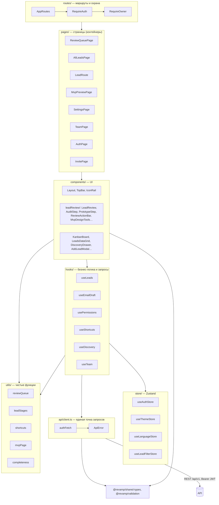
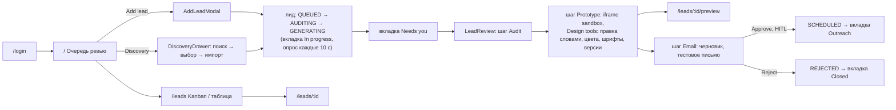

# Front-end expertise: Revamp — дашборд оператора, архитектура и обоснование

22 ноября 2026

Документ для экспертной оценки критерия **Front-end** (обязательный критерий, `04d-frontend-and-ux/frontend.md`). Разделы 1–11 закрывают обязательную документацию и минимальные требования, раздел 12 — направления максимальной оценки, раздел 13 — сводная таблица соответствия и что осталось доделать.

## 1. Репозиторий и запуск

Фронтенд — пакет `apps/dashboard` монорепозитория [yurykurouski/revamp-dev](https://github.com/yurykurouski/revamp-dev) (публичный). Это SPA на React 18 + TypeScript, собранная Vite, с Material UI v6. Работает с REST API `apps/api` (раздел 6).

```bash
npm run setup          # один раз: зависимости, .env, MongoDB/Redis/MinIO
npm run dev            # API :4000, воркеры, дашборд http://localhost:5173
npm run db:seed        # демо-студия и лиды; вход demo-owner@revamp-demo.test (пароль — в README, раздел Demo data)
```

| Что | Где |
| --- | --- |
| Исходники | `apps/dashboard/src` — 98 модулей `.ts/.tsx` |
| Тесты | `apps/dashboard/src/**/__tests__` — 63 файла, 708 тестов (Vitest + happy-dom) |
| Правила области | `apps/dashboard/AGENTS.md` |
| Сборка в контейнер | `apps/dashboard/Dockerfile` + `nginx.conf` (статическая отдача, fallback на `index.html` для маршрутов SPA) |
| API, с которым работает клиент | [`api-docs/`](api-docs/README.md) в этом репозитории: OpenAPI-спецификация, руководства, примеры |

## 2. Подход к архитектуре

**Компонентный подход с разделением серверного и клиентского состояния.** Вместо одного глобального стора (Flux/Redux) состояние разделено по природе данных:

| Вид состояния | Чем управляется | Примеры |
| --- | --- | --- |
| **Серверное** (лиды, аудиты, MVP, участники студии) | TanStack React Query: кэш, фоновое обновление, инвалидация после мутаций | `useLeads`, `useLeadStats`, `useDiscovery`, `useTeam` |
| **Глобальное клиентское** (сессия, тема, язык, фильтры, выбор LLM, поиск бизнесов) | 6 сторов Zustand, часть сохраняется в `localStorage` | `useAuthStore`, `useThemeStore`, `useLanguageStore`, `useLeadFilterStore`, `useLlmChoiceStore`, `useDiscoveryStore` |
| **Локальное** (открытый диалог, текст поля, шаг ревью) | `useState` / `useReducer` в компоненте | `AddLeadModal`, `LeadReview` |
| **URL** (какая страница, какой лид открыт) | React Router | `/leads/:id`, `/leads/:id/preview` |

Почему так: 90 % данных дашборда — это копия состояния сервера, которое меняют фоновые воркеры (аудит идёт ~40 с, генерация — минуты). Держать её в Redux значило бы вручную писать загрузку, повторы, опрос и инвалидацию; React Query делает это из коробки (`refetchInterval: 10000` для списка лидов). Zustand остаётся для небольшого настоящего клиентского состояния, где Redux-обвязка (actions, reducers, провайдер) не окупается.

Слои внутри `src` (зависимости идут только вниз):



## 3. Структура проекта

```
apps/dashboard/src/
├── main.tsx, App.tsx      # точка входа: QueryClient, ThemeProvider, BrowserRouter
├── routes/                # AppRoutes (таблица маршрутов), paths.ts (ROUTES), RequireAuth, RequireOwner
├── pages/                 # 8 страниц-контейнеров
├── components/            # 28 UI-компонентов
│   └── leadReview/        # 14 компонентов ревью лида: шаги Audit / Prototype / Email, инструменты дизайна
├── hooks/                 # 10 хуков: запросы (React Query), черновик письма, права, горячие клавиши
├── store/                 # 6 сторов Zustand
├── api/client.ts          # authFetch, ApiError, apiClient / authApi / organizationApi / invitationApi, мапперы
├── utils/                 # 14 модулей чистой логики (очередь ревью, стадии, проверки MVP, шорткаты)
├── theme/theme.ts         # MUI-тема: токены светлой и тёмной схем, типографика, переопределения компонентов
└── i18n/                  # i18next, 5 языков: en, ru, be, pl, lt
```

Модели данных не объявляются заново: ответы API типизированы как `Serialized<ILead>`, `Serialized<IAudit>`, `Serialized<IMvpProject>` из `@revamp/shared-types` (`Serialized<T>` превращает `Date` в строку, как в JSON). Стили — только через тему MUI (`sx` с токенами вроде `text.secondary`, `stage.sent`), без захардкоженных цветов (правило `apps/dashboard/AGENTS.md`); `style={{…}}` встречается в трёх местах, где значение вычисляется во время работы (позиция перетаскиваемой панели, размеры iframe).

## 4. Маршруты и навигация

| Маршрут | Страница | Доступ |
| --- | --- | --- |
| `/login`, `/register` | `AuthPage` | публичные |
| `/invite/:token` | `InvitePage` — присоединение по приглашению | публичный |
| `/` | `ReviewQueuePage` — очередь ревью: вкладки-корзины, список, ревью выбранного лида | вход |
| `/leads` | `AllLeadsPage` — Kanban и таблица всех лидов | вход |
| `/leads/:id` | `LeadRoute` — ревью лида на весь экран | вход |
| `/leads/:id/preview` | `MvpPreviewPage` — прототип на всё окно с инструментами дизайна (вне оболочки приложения) | вход |
| `/settings` | `SettingsPage` — язык, тема, LLM по умолчанию | вход |
| `/team` | `TeamPage` — участники и приглашения | только владелец (`RequireOwner`) |
| `*` | редирект на `/` | — |

Поиск бизнесов (Discovery) — выезжающая панель поверх любой страницы, а не маршрут: оператор не теряет контекст очереди.

Основной сценарий оператора:



Ревью лида — единственное место, где можно одобрить письмо (`ReviewActionBar` на шаге Email): так человек всегда видит аудит, прототип и текст перед отправкой (Human-in-the-Loop).

## 5. Управление состоянием

* **React Query.** Ключи запросов вынесены в `hooks/useLeads.ts` (`LEADS_QUERY_KEY` и др.); мутации (`useMutation`) инвалидируют их. Список лидов и счётчики опрашиваются каждые 10 с, поиск бизнесов — с интервалом, зависящим от состояния задачи (`discoveryRefetchInterval`). `QueryClient`: `retry: 1`, без перезапроса при фокусе окна.
* **Zustand.** Сессия (`useAuthStore`: токен, пользователь, студия, роль) хранится в `localStorage`; при выходе кэш React Query очищается (`useClearCacheOnSignOut`), чтобы следующий пользователь не увидел чужих данных. Тема и язык тоже сохраняются между сессиями.
* **Логика без React.** Порядок и выбор в очереди (`utils/reviewQueue.ts`), соответствие статусов колонкам и корзинам (`utils/leadStages.ts`), реестр горячих клавиш (`utils/shortcuts.ts`) — чистые функции, поэтому покрыты быстрыми unit-тестами.

## 6. Работа с API

* **Одна точка запросов** — `api/client.ts`. Все вызовы идут через `authFetch`: добавляет `Authorization: Bearer`, на `401` выходит из сессии, на `403` перечитывает роль (`GET /auth/me`). Только `register`/`login` используют обычный `fetch` (там `401` — неверный пароль, а не истёкшая сессия).
* **Ошибки API** приходят в одном формате `{ success: false, error: { code, message, details? } }` и превращаются в `ApiError` (`message`, `status`, `code`, `details`); компоненты ветвятся по `code`.
* **Типы** — из `@revamp/shared-types`; мапперы (`mapServerLead`, `mapServerAudit`) читают только поля, которые API действительно возвращает, а запись без `_id` считается ошибкой ответа.
* **Документация API**, с которым работает клиент: [`api-docs/reference/openapi.yaml`](api-docs/reference/openapi.yaml) (OpenAPI 3.0.3, 39 операций, схемы, примеры запросов и ответов, коды ошибок) и руководства в `api-docs/guides/`.

## 7. Формы, таблицы, фильтры

| Требование | Реализация |
| --- | --- |
| Контролируемые формы | `AddLeadModal`, `AuthPage` (вход, регистрация), `InvitePage`, `DiscoveryDrawer`, `EmailDraftEditor`, `MvpEditPrompt`, `TeamPage` (приглашение) |
| Валидация форм | Те же Zod-схемы, что у API, из `@revamp/validation` (например, `QuickAddLeadSchema.safeParse` в `AddLeadModal`); ошибка показывается в `Alert` у формы. Контраст цветов MVP проверяется на лету (`MVP_MIN_CONTRAST`) |
| Таблицы и списки | `LeadsDataGrid` (MUI X DataGrid: сортировка, пагинация), `KanbanBoard` (колонки по стадиям), список очереди ревью, список кандидатов Discovery, список участников |
| Фильтр, поиск, сортировка | Поиск в `TopBar`, быстрые фильтры по статусу и диапазону оценки (`useLeadFilterStore`, `utils/reviewQueue.ts`), сортировка колонок таблицы, фильтр сложности сайта |

## 8. Ошибки и состояния загрузки

| Ситуация | Что видит пользователь |
| --- | --- |
| `401` | Сессия сбрасывается, переход на `/login` с возвратом на исходную страницу после входа (`RequireAuth` сохраняет `from`) |
| `403` | Роль перечитывается; кнопки записи у `viewer` скрыты или неактивны заранее (`usePermissions`), есть уведомление «только чтение» |
| `404` | Лид или MVP не найден — сообщение на месте контента; неизвестный маршрут — редирект на `/` |
| `409` / `5xx` | Текст `error.message` в `Alert` или `Snackbar` рядом с действием (генерация, перегенерация, одобрение, правки MVP); для `502`/`504` правок MVP — объяснение из `pageResultText` |
| Загрузка | `Skeleton` (настройки, команда, выбор модели), `CircularProgress` / `LinearProgress` на кнопках и в списках (19 компонентов), оверлей перегенерации |
| Пусто | Пустые состояния корзин очереди и списков |

**Чего нет:** глобального `ErrorBoundary` — исключение при рендере сейчас роняет всё приложение; ошибки не логируются в консоль или сервис (раздел 13). Задача на исправление — [REV-212](https://linear.app/revamp-proect/issue/REV-212/dashboard-global-errorboundary-and-client-error-logging).

## 9. Интерфейс: UI-кит, адаптивность, тема, доступность

* **UI-кит:** Material UI v6 + собственные компоненты поверх него (`ScoreChip`, `KeyCaps`, `FloatingToolsPanel`, `RevampLogo`), MUI X DataGrid, иконки `lucide-react` и `@mui/icons-material`.
* **Адаптивность:** брейкпоинты MUI в `sx` — очередь ревью перестраивается из двух колонок (`lg`) в одну, панель Discovery занимает всю ширину на `xs`, поиск растягивается, редактор письма и аудит складываются в одну колонку.
* **Тема:** светлая и тёмная схема (`useThemeStore`, токены `TOKENS` в `theme/theme.ts`); `theme.spec.ts` проверяет, что пары цветов проходят WCAG AA.
* **Доступность:** `aria-*` в 26 компонентах, `aria-keyshortcuts` из реестра горячих клавиш; 14 шорткатов в одном реестре `SHORTCUTS` с проверкой конфликтов и подсказкой `?`.
* **Языки:** 5 локалей (en, ru, be, pl, lt), около 860 строк в каждой; тесты i18n проверяют, что ключи совпадают во всех локалях.
* **Безопасность превью:** прототип встраивается только в `<iframe sandbox="allow-scripts allow-same-origin">`.

## 10. Тестирование

708 тестов в 63 файлах дашборда, Vitest; компоненты рендерятся в happy-dom через `react-dom` (без Testing Library). Запуск — `npm test` из корня; CI (`.github/workflows/ci.yml`) прогоняет их на каждом PR.

| Слой | Файлы | Что проверяется |
| --- | --- | --- |
| Сторы | `store/__tests__` (3) | Переходы состояния, сброс фильтров, сохранение сессии |
| API-клиент | `api/__tests__` (2) | `authFetch` (выход на 401, обновление роли на 403), мапперы, `ApiError` |
| Хуки | `hooks/__tests__` (6) | Опрос, мутации, права, шорткаты, черновик письма |
| Компоненты | `components/__tests__` (27) | Формы и их валидация, состояния загрузки и ошибок, ревью лида, инструменты дизайна |
| Страницы и маршруты (интеграционные) | `pages/__tests__` (6), `routes/__tests__` (2) | `ReviewQueuePage` и `AppShell` рендерят настоящие `AppRoutes` с React Query и роутером и подменённым `fetch`: навигация, выбор лида, фильтры, вход и права |
| Логика, тема, i18n | `utils/__tests__` (12), `theme`, `i18n` | Очередь ревью, стадии, контраст темы, полнота локалей |

Каждое изменение дашборда в пайплайне тикета дополнительно проверяется вручную в Chrome без новых ошибок в консоли.

## 11. Качество кода

* TypeScript `strict` с `noUncheckedIndexedAccess` и `noImplicitReturns` (`tsconfig.base.json`); в исходниках дашборда нет ни одного `any`.
* ESLint 9 (`eslint.config.js`, `@typescript-eslint`, `no-explicit-any: warn`) и Prettier 3 (`.prettierrc`) на весь монорепозиторий; `npm run lint`, `npm run typecheck`, `npm test` и `npm run build` — обязательные проверки CI.
* Секретов в коде нет: токен сессии приходит от API и лежит только в `localStorage` браузера; адрес API задаётся окружением.

### Обоснование стека

| Выбор | Почему | Альтернативы и почему нет |
| --- | --- | --- |
| **React 18 + TypeScript** | Типы общие с API и воркерами (`@revamp/shared-types`, Zod-схемы `@revamp/validation` переиспользуются в формах) — один язык на всё | Angular: модули и DI тяжелее для одного разработчика; Vue: меньше готовых компонентов уровня DataGrid |
| **Vite** | Мгновенный dev-сервер, сборка за ~5 с, алиасы на исходники общих пакетов | CRA устарел, Webpack требует ручной настройки |
| **Material UI v6 + MUI X** | Готовые доступные компоненты, DataGrid, система тем со светлой/тёмной схемой и токенами | Ant Design: тяжелее кастомизировать тему; Tailwind: пришлось бы писать доступные компоненты самому |
| **TanStack React Query** | Данные меняют воркеры в фоне: нужен кэш с опросом и инвалидацией | Redux Toolkit Query: тянет Redux целиком ради того же |
| **Zustand** | Небольшое клиентское состояние без провайдеров и boilerplate | Redux Toolkit: избыточен при 6 маленьких сторах; Context: перерисовывает всё дерево |
| **React Router 7** | Вложенные маршруты, охрана через `<Outlet>` | TanStack Router: моложе, меньше примеров |
| **i18next** | 5 языков интерфейса, интерполяция и множественные формы | Собственный словарь: без плюрализации |

## 12. Направления максимальной оценки

Требуется 2–3 направления из четырёх. Сильнее всего закрыто направление 4, частично — 2.

| Направление | Что есть | Чего нет |
| --- | --- | --- |
| **4. Advanced UI/UX** — основное | Светлая/тёмная тема с проверкой контраста WCAG AA в тестах; собственные компоненты поверх MUI; ARIA, горячие клавиши с реестром и подсказкой, `aria-keyshortcuts`; анимации переходов MUI (`Fade`, `Collapse`, `Slide`); 5 языков; KPI-счётчики воронки | Графиков (charts) нет — счётчики только числами |
| **2. Advanced State Management** — частично | Разделение серверного (React Query) и клиентского (Zustand) состояния; цепочки асинхронных операций: правка MVP ждёт воркер до 420 с, очередь ревью удерживает выбранный лид, пока воркер переводит его в другую корзину (`keepSelectedLead`); опрос с интервалом по состоянию; мемоизация вычислений (`useMemo`) | Селекторов и effects в стиле Redux нет по выбору архитектуры (раздел 2) |
| **1. Advanced Architecture** — частично | Строгие слои (раздел 2), общие типы и схемы с бэкендом | Нет lazy loading маршрутов, нет feature-модулей в стиле FSD |
| **3. Performance** | Опрос вместо перезагрузки страниц; кэш React Query | Один бандл 1,48 МБ (450 КБ gzip), без code splitting; `React.memo` не используется; Lighthouse не замерялся |

## 13. Соответствие требованиям

Минимальные требования (оценка 5):

| # | Требование | Статус | Где / что добавить |
| --- | --- | --- | --- |
| 1 | Диаграмма архитектуры: модули, компоненты, маршруты, состояние | Есть | Раздел 2 |
| 2 | Описание подхода к архитектуре | Есть | Раздел 2: компонентный подход, разделение серверного и клиентского состояния |
| 3 | Документация API, с которым работает клиент | Есть | `api-docs/`: OpenAPI, схемы, примеры запросов и ответов |
| 4 | Диаграмма пользовательских сценариев и навигации | Есть | Раздел 4 |
| 5 | Обоснование стека | Есть | Раздел 11 |
| 6 | Компоненты / страницы / хуки-сервисы | Есть | `components/`, `pages/`, `hooks/` + `api/` (раздел 3) |
| 7 | Маршрутизация (3–4+ маршрута) | Есть | 9 маршрутов, охрана по входу и роли |
| 8 | Локальное + глобальное состояние | Есть | `useState`, 6 сторов Zustand, React Query |
| 9 | Ясная структура проекта | Есть | Раздел 3 |
| 10 | Реальный API, типы, централизованные запросы, ошибки и загрузка | Есть | `api/client.ts`, `Serialized<T>`, `ApiError` |
| 11 | Сборщик | Есть | Vite 6 |
| 12 | Переиспользуемые и layout-компоненты, UI-библиотека | Есть | `Layout`, `TopBar`, `IconRail`, MUI v6 |
| 13 | Формы, валидация, таблицы, фильтр/поиск/сортировка | Есть | Раздел 7 |
| 14 | Адаптивная вёрстка (десктоп + мобильный) | Частично | Брейкпоинты есть (раздел 9), но мобильный вид целиком не проверялся: **до сдачи пройти все страницы на 375 px** и сделать скриншоты. Задача — [REV-214](https://linear.app/revamp-proect/issue/REV-214/dashboard-check-and-fix-the-mobile-layout-at-375-px-on-every-page) |
| 15 | ESLint + Prettier | Есть | `eslint.config.js`, `.prettierrc`; скрипта `format` нет — стоит добавить `prettier --check` в CI |
| 16 | Базовое логирование ошибок | **Нет** | В дашборде нет ни одного `console.error`: **добавить логирование в `authFetch` (ответы 5xx и сетевые ошибки) и в `ErrorBoundary`**. Задача — [REV-212](https://linear.app/revamp-proect/issue/REV-212/dashboard-global-errorboundary-and-client-error-logging) |
| 17 | Глобальный обработчик ошибок (interceptor / error boundary) | Частично | Interceptor есть (`authFetch`: 401/403), **`ErrorBoundary` нет — добавить вокруг `AppRoutes`** с экраном «Что-то пошло не так». Задача — [REV-212](https://linear.app/revamp-proect/issue/REV-212/dashboard-global-errorboundary-and-client-error-logging) |
| 18 | Понятные сообщения (toast/snackbar/dialog) | Есть | `Alert`, `Snackbar` у действий |
| 19 | Корректная обработка 401/403/404/500 | Есть | Раздел 8 |
| 20 | Skeleton / загрузка для всех асинхронных операций | Частично | Индикаторы есть в 19 компонентах; стоит пройтись по каждому запросу и убедиться, что пустой экран при загрузке нигде не виден |
| 21 | Unit-тесты ≥ 3 ключевых компонентов/сервисов | Есть | 708 тестов, раздел 10 |
| 22 | Integration/e2e тесты (1–2) | Частично | Интеграционные тесты страниц с настоящим роутером есть (`ReviewQueuePage.spec.ts`, `AppShell.spec.ts`); **браузерного e2e нет — добавить 1–2 сценария Playwright** (вход → очередь → открыть лид), Playwright уже стоит в монорепозитории. Задача — [REV-213](https://linear.app/revamp-proect/issue/REV-213/dashboard-browser-e2e-tests-with-playwright-for-sign-in-and-lead) |
| 23 | Нет инлайн-стилей без причины, одного компонента на всё, секретов в коде, необработанных ошибок API, `any` без причины | Есть | Три `style` с вычисляемыми значениями (раздел 3), 0 `any` |

**Итог.** Обязательная документация закрыта полностью. По коду закрыто большинство минимальных пунктов; до встречи с экспертом стоит закрыть три пробела, на каждый заведена задача в Linear (проект Revamp: Lead Generation SaaS (Diploma)):

1. `ErrorBoundary` вокруг маршрутов + логирование ошибок (пункты 16 и 17) — [REV-212](https://linear.app/revamp-proect/issue/REV-212/dashboard-global-errorboundary-and-client-error-logging).
2. Один-два e2e-сценария на Playwright (пункт 22) — [REV-213](https://linear.app/revamp-proect/issue/REV-213/dashboard-browser-e2e-tests-with-playwright-for-sign-in-and-lead).
3. Проверка мобильного вида на 375 px со скриншотами (пункт 14) — [REV-214](https://linear.app/revamp-proect/issue/REV-214/dashboard-check-and-fix-the-mobile-layout-at-375-px-on-every-page).

Для максимальной оценки — направление 4 (UI/UX) закрыто, для второго направления проще всего добавить **lazy loading маршрутов** (`React.lazy` для `MvpPreviewPage`, `TeamPage`, `SettingsPage`, `AllLeadsPage`) и **замер Lighthouse**, что одновременно продвигает направления 1 и 3.
